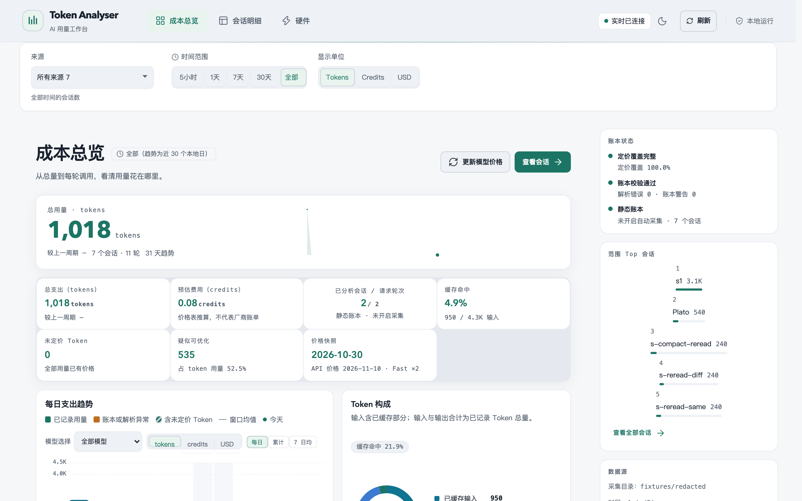
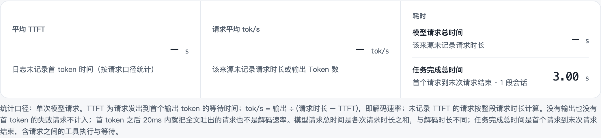
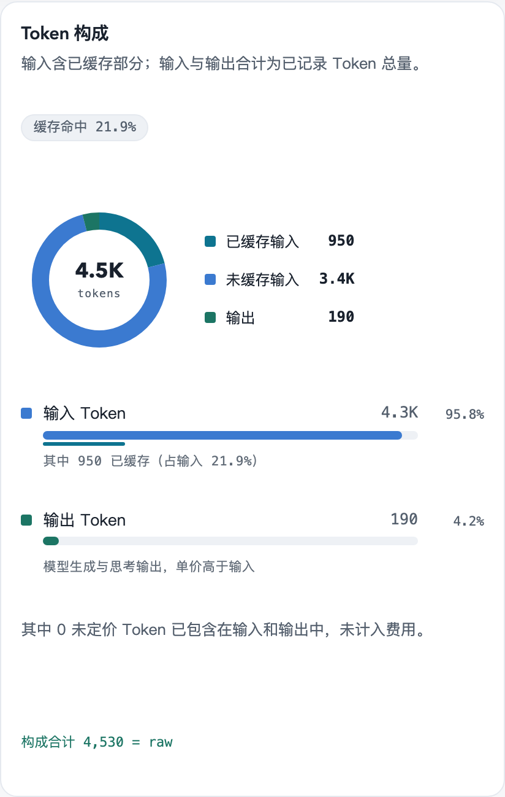

# Token Analyser

Local dashboard for Codex, Claude Code, Cursor, pi, DeepSeek Harness, and OpenCode sessions. The Node engine reads local JSONL (and DSH's zstd-compressed JSONL) plus Cursor's and OpenCode's SQLite stores; the Vite UI talks to it over HTTP and SSE. Session data stays on the machine. Figures come from recorded usage or dated public API rates; they are not subscription bills.







Screenshots use the redacted fixtures, not a subscription bill.

## Run

```bash
pnpm install
pnpm dev
```

Use Node.js 22.15+ on the 22.x line, or 23.8 and later. Cursor and OpenCode use `node:sqlite`; DeepSeek Harness uses the built-in Zstandard decoder. `.nvmrc` pins the minimum supported release.

`pnpm dev` starts Vite and the engine together. The API proxy waits for the engine on `127.0.0.1:7789`. Open the UI at [http://127.0.0.1:7788](http://127.0.0.1:7788).

Single-process production-style serve (engine hosts `apps/web/dist`):

```bash
pnpm start
```

`pnpm start` reuses the production UI after checking the source inputs and built assets. It builds on the first run and after changes. `pnpm build` always builds explicitly.

The same server is the publishable CLI entry (`package.json` `bin` and `files`). Build the UI once, then:

```bash
pnpm exec token-analyser
```

That listens on [http://127.0.0.1:7788](http://127.0.0.1:7788). `token-analyser analyse path/to/session.jsonl` prints one snapshot. After the package is published, the same bin is what `npx token-analyser` and `npm i -g token-analyser` run. The workspace root stays `private` so a local `pnpm` install is not published by accident.

Print a snapshot for one rollout file:

```bash
pnpm analyse path/to/rollout.jsonl
```

Default sources are discovered recursively:

| Source | Local records | Analysis |
| --- | --- | --- |
| Codex | `~/.codex/sessions/**/*.jsonl` (`CODEX_HOME` supported) | Tokens, credits, USD, tools; agent-task TTFT and tok/s when logged |
| Claude Code | `~/.claude/projects/**/*.jsonl` (`CLAUDE_CONFIG_DIR` supported) | Input, cache read/write, output, API-equivalent USD, tools, subagents |
| Cursor | `~/.cursor/projects/**/agent-transcripts/**/*.jsonl` and Cursor User `globalStorage/state.vscdb` / `workspaceStorage/**/state.vscdb` | Conversation, tools, session metadata, Cursor's own context-token meter; request usage, TTFT and tok/s are not recorded |
| pi | `~/.pi/agent/sessions/**/*.jsonl` (`PI_CODING_AGENT_DIR` supported) | Input, cache read/write, output, recorded USD, tools, branch/fork context, per-request duration (tok/s); TTFT with the [pi request-timing extension](#pi-request-timing) |
| DeepSeek Harness | `~/.dsh/sessions/**/session*.jsonl.zstd` (`DSH_HOME` supported) | Input, cache read, output, tools, subagent parent links; tok/s from per-message stream timing when present |
| OpenCode | `$XDG_DATA_HOME/opencode/opencode.db`, otherwise `~/.local/share/opencode/opencode.db` (Windows: `%LOCALAPPDATA%/opencode/opencode.db`) | Input, cache read/write, output, reasoning, recorded USD or API-equivalent estimate, tools, parent sessions; TTFT and tok/s from message stream times when present |
| Antigravity | `~/.gemini/antigravity/brain/<id>/.system_generated/logs/transcript.jsonl`, plus `antigravity-cli` and `antigravity-ide` | Input, cache read, output, tools; model from the Model Selection line. `transcript_full.jsonl` and `chunks/` are not counted again. TTFT and tok/s are not recorded |

Cursor's User directory is `~/Library/Application Support/Cursor/User` on macOS,
`%APPDATA%/Cursor/User` on Windows, and `$XDG_CONFIG_HOME/Cursor/User` (or
`~/.config/Cursor/User`) on Linux. Its databases are opened read-only; active WAL
changes are watched. The database schema is internal to Cursor and may change.
Zero-valued Cursor token placeholders are treated as missing telemetry, not
measured zero. The UI shows `—` for missing usage and `≥` for partial totals.
TTFT and tok/s stay unavailable for logs that do not record the required timings.
The performance panel states which unit it measured: **整次 agent 任务** (Codex
`task_started` / `task_complete` windows) or **单次模型请求** (sources that
record request timing, such as pi's `durationMs`). The two are never mixed, and
neither is derived from gaps between log timestamps. A source that records
neither request duration nor output tokens — including Cursor, whose local store
keeps both at zero — reports `—` with the reason stated.
The request detail table and its expanded rows show TTFT (seconds) and tok/s
for each LLM call. Request-level `time_to_first_token_ms` / `ttft_ms`,
`duration_ms`, and `output_tokens_per_second` fields are read from the call's
metadata (including `metrics`, `timing`, `request_performance`, pi's
`durationMs`, and the [pi request-timing extension](#pi-request-timing)).
Recorded speed takes precedence. Otherwise tok/s is output tokens divided by
the generation window, and each row names the denominator it used: **解码时长**
(request duration minus TTFT) when the request recorded a first-token time,
**请求总耗时** (whole window, first-token wait included) when it logged only a
duration. The session summary divides summed output by summed generation
windows, so its rate covers exactly the requests that have a window, and TTFT
is averaged over the requests that recorded one. A first-token time that
exceeds the logged window stays a valid TTFT; that request's tok/s is `—`
because the two recorded numbers leave no decode window. Task-level
measurements are kept in the summary and are not copied into individual request
rows.

### pi request timing

pi's log carries three time facts per request — `message.timestamp` (request
start), the entry `timestamp` (request end), and `durationMs` — so the
first-token instant is absent and cannot be recovered from them. Historical pi
sessions therefore keep `日志未记录首 token 时间`.

`integrations/pi/request-timing.ts` measures it where it happens:

```bash
cp integrations/pi/request-timing.ts ~/.pi/agent/extensions/request-timing.ts
```

Each model request then appends a `request_timing` session entry with
`ttft_ms` (provider request sent → first output delta), response-header time,
the first raw stream chunk, retry count, and pi's own duration. The analyser
joins the entry to its model call by assistant entry id (`turn_end.messageEntryId`),
falling back to `responseId`, and feeds `ttft_ms` into the same request-basis
TTFT summary, histogram, and detail table as any other recorded field, because
it is a measurement taken inside the request and not an inference from log
gaps. pi's own `durationMs` on the assistant entry stays the reported duration;
the entry's `piDurationMs` (or its own `startedAt` → `endedAt` window) is used
only when that entry records none. With both known, turn tok/s is a decode rate
over `durationMs − ttft_ms` instead of the full-window rate, and the row says
so. Retries restart the extension's clock, so the sample describes the attempt
that produced the message and `attempts` keeps the retries visible. Toggle the
extension in pi with `/request-timing` or set `PI_REQUEST_TIMING=0`; the entry
stores no prompt or response text.

Cursor records how much context a conversation held
(`promptTokenBreakdown`, `contextTokensUsed`, `contextTokenLimit`,
`contextUsagePercent`). The session's **上下文与会话信息** section shows that
meter as a context size with its category breakdown. It is a context
measurement, not billable token usage, so it never enters the token ledger, cost
or cache-hit figures.

Use the visible **环境** control to read sessions from this machine or from `192.168.1.102` (SSH as `john`, read-only). Use **会话来源** to select all sources,
Codex, Claude Code, Cursor, pi, DeepSeek Harness, OpenCode, or Antigravity in both the overview and session detail views.
A remote environment reopens its local mirror after a restart. Previously synced
sessions are available while SSH checks for new records, including when the host
is offline. The UI shows the last recorded sync time when available. The global Cursor and OpenCode mirrors copy SQLite
and its WAL together and verify that the source generation stayed stable.
Source counts include all discovered root sessions across all time. The default
7-day range can hide older sessions; **查看全部时间** reveals that history.
The selected source is restored on reload and browser back navigation.
Search the session list by source name, model, directory, or session ID.
Claude streaming records sharing a message ID are combined using the latest
reported usage fields. Claude subagent paths identify their parent session.
pi forks exclude entry IDs copied from an available parent file; if that file is
missing, only the child log can be analysed and inherited spend cannot be
distinguished. Branch context follows entry `parentId` rather than file order.

Optional `~/.token-analyser/config.json` replaces the default discovery paths.
Use an empty `watch_paths` array to disable discovery while retaining imports.

```json
{
  "watch_paths": ["/absolute/path/to/sessions"],
  "usd_per_credit": 0.05,
  "usd_per_cny": 0.15
}
```

Codex rate card: `config/rate-card.json`. API-equivalent rates:
`config/api-prices.json` (dated, sourced from official pricing pages). Recorded
USD takes precedence; a turn whose log records 0 spend counts as unbilled and is
estimated from the official rate. Credits apply only to Codex; Claude, Cursor, pi, DeepSeek Harness, and
OpenCode costs are never converted to Codex credits. The price update button refreshes the Codex
card and the Qwen rates in `config/api-prices.json`; a publisher that cannot be
reached leaves its own local rates untouched and the UI says which source
failed. The `qwen` block owns Qwen updates: each entry names the official model
ID, the pricing-page section and region tab to read, the CNY rates last
accepted, the `cache_hit_ratio` / `cache_write_ratio` read from the page's
cache note, and the `usd_per_cny` conversion (override it with `usd_per_cny` in
`config.json`). Model IDs listed under `qwen.models[*].aliases` price as their
canonical model for any provider, so a relay that reports its own name —
`swift-1.5-iq3_xxs` serving `qwen3.8-flash-next` — never falls back to `—`. Only the public pricing
document is fetched; session data never leaves the machine. The engine refreshes
Qwen rates on startup and hourly whenever the card's Qwen date is not today's
date, then re-prices local sessions; set `QWEN_PRICING_AUTO_UPDATE=0` to pin
them.
`~/.token-analyser/store.db` stores full session evidence and a compact index for
the list and overview. A compatible older dump builds the index once. Opening a
session loads the evidence for that session and its children. Changed snapshots
and their file fingerprints commit together.

On startup the engine serves the UI and hardware routes while restoring the
ledger. It checks the configured roots before displaying saved session data,
then reconciles changed logs and SQLite databases in a parser worker. During
initial indexing the dashboard shows progress and updates as files become
available. A parser-version or effective-price change may require rebuilding
from the source logs. The legacy parse-cache directory is `~/.token-analyser/cache/`.
Imported `.jsonl` / `.ndjson` files are copied to
`~/.token-analyser/imports/` and restored on the next launch. Existing imports
are never overwritten by another file with the same name.
The CLI also accepts a Cursor `state.vscdb`; `--json` returns an array for a
database and one snapshot for JSONL. To import a database through the API, use
`POST /import` with JSON `{ "path": "/absolute/path/to/state.vscdb" }`; database
uploads are not supported because an active WAL belongs to the original store.
Path imports are saved as links and read again at startup. If a path imported
before link tracking is outside the discovery roots, submit it once to save
the link. Uploaded session files continue to restore from the imports directory.

The dashboard shows pricing coverage and ledger/parse health beside the headline
figures. The session ranking uses the same round-level window as the total
and follows the selected unit. Open a behaviour row to filter its contributing
sessions. Rolling windows update while the overview is visible. Daily trends
use the browser's IANA timezone (with numeric-offset fallback), and the shipped rate card is dated so historical estimates remain
auditable. Unknown models keep their token counts and display money as `—`
instead of silently borrowing another model's price; model IDs must match an
explicit entry in the dated rate card.

Fast mode is accounted per turn, so switching `/fast` on or off during a
conversation changes only the affected turns. Each Fast turn is marked in the
detail table, and model-specific multipliers come from the dated rate card.
Desktop `thread_settings_applied` tiers and per-turn `fast` / `priority` tiers
are recognized. Expanded turns show the effective input, cached-input, and
output prices per million tokens. Updating model prices also synchronizes the
official purchased-credit Fast multiplier (currently 2× Standard). Included
subscription allowance uses a different multiplier and is not estimated here.

The behavior breakdown uses mutually exclusive categories: planning and
thinking, source reading and search, tests/builds/checks, code changes and
execution, duplicate reads, tool/environment operations, user messaging,
polling and coordination waits, and a final “other / unknown” fallback. A
turn is only kept in the fallback when its tool shape does not match any of
the explicit rules, so the breakdown remains auditable instead of hiding all
read or verification work in one bucket.

## Hardware electricity preview

Open **硬件用电** (`#power`) for CPU, GPU, and whole-machine power in W,
range energy in kWh, and electricity cost in CNY. Choose a rolling 1-hour,
24-hour, or 7-day range, or a custom interval of up to 31 days. The default
price is **0.6629 CNY/kWh** and stays editable. Whole-machine energy and cost
are the page's primary readings. They carry the largest type on the page and a
compact summary under the page title, and the price label keeps all four
decimals (0.6629, never 0.66). Whole-machine readings include the component readings. The default GPU query
sums the distinct devices on the configured collector and merges duplicate
scrapes for the same device.

Sampling is split into two layers so the curve stays readable without
thinning the data: the **sampling grid** feeds the trapezoid integration and is
15 s for 1 hour, 1 minute for 24 hours, 10 minutes for 7 days, and 30 minutes
for a 31-day custom range (capped at ~2 000 samples per request); the **chart
bucket** only aggregates those samples into per-column means (30 s / 10 min /
2 h / 8 h) plus the peak inside each bucket, shown on hover. Energy, average
power and peak power therefore never use the bucketed series, so a spike
between two old 15-minute points is no longer averaged away.

The engine reads power samples from a configured local Prometheus HTTP API
(`~/.token-analyser/config.json` → `power.prometheus_url`, optional `queries`).
Only that configured address is contacted; session data never leaves the
machine. When the collector is unreachable the API returns `connected: false`
and the page keeps the reading empty. Deterministic demo data is off unless
the engine process is started with `ENABLE_POWER_PREVIEW=1` (`true` and `yes`
count too). The UI reads that single flag from `GET /config` in both `pnpm dev`
and `pnpm start`, so a prebuilt bundle does not need a rebuild. `VITE_ENABLE_POWER_PREVIEW`
is not read: Vite would freeze it at `pnpm build`.
Missing samples break the integral and produce a clearly labelled lower bound;
absent readings show `—`. Demo electricity costs never enter Token cost totals.
`apps/web/src/hardware-power.ts` is the adapter boundary for both series.

The hardware temperature page (`#hardware-temp`) uses the same Prometheus
configuration. It polls a current snapshot every two seconds, loads a longer
history for the selected window, and accepts custom metric queries and device
names via `power.temps`. Live queries limit each sensor's lookback to 20 seconds.
Any observed GPU over-limit reading takes priority in the protection banner,
including when another sensor is missing. The global Refresh button reloads
telemetry for the visible hardware page. A failed history read is labelled and retryable
without blocking live samples; no fabricated temperatures are inserted when
the collector is unavailable.

## Adding a source

New agent logs follow the pi JSONL adapter or the Cursor SQLite adapter.
Steps, the files to touch, and where the fixture test goes are in
[docs/adding-a-source.md](docs/adding-a-source.md).

## Test

```bash
pnpm test
```

Runs engine and web unit tests. Playwright (needs browsers):

```bash
E2E=1 pnpm test
```
